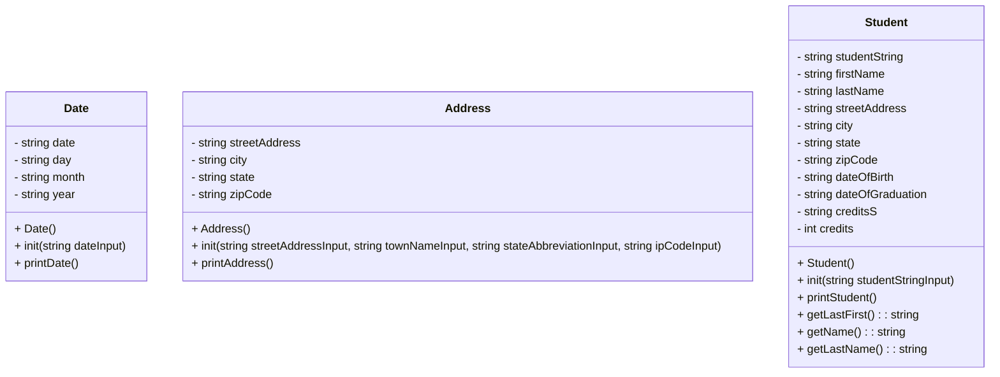

# CS121-Project-7-Heap-Of-Students-Part-2
### This is part 2 of the first heap of students project



## Student::init(std::string studentStringInput)
```
put studentStringInput into studentString
clear ss and converter to make sure they are empty
put studentString into ss
use getline() with a comma delininator to give all the variables their values from the string
clear the whitespace in each variable so there isn't a space before each value
when we get to the credits part, instead of putting it directly into the credits variable, put it into creditsS. then put creditsS into converter, and then converter into credits. that makes it into an int
```

## Student::printStudent()
```
prints all the variables of the student
```

## Student::getLastFirst()
```
returns the last name and then the first name as strings
```

## Student::getName()
```
returns first and last name as string
```

## Student::getLastName()
```
returns last name as string
```

## Date::init(std::string dateInput)
```
fill dateString with dateInput

create a stringstream and fill it with dateInput

fill date variables using getline() on the stringstream with the delimeter /
```

## Date::printDate()
```
prints date
```

## Address::init(std::string streetAddressInput, std::string cityInput, std::string stateInput, std::string zipCodeInput)
```
puts the values of the parameters in their respective variables
```

## Address::printAddress()
```
prints out all the address variables
```

## main()
```
include iostream, fstream, sstream, string, vector, algorithm, Address.h, Date.h, Student.h

void fillVector(reference to vector of students, string fileName)
void printVector(reference to vector of students)
void printStudentNames(reference to vector of students)
bool sortByName(Student a, Student b)
void findStudent(refernce to vector of students)
void printMenu()

int main() {
    vector of students
    fill vector

    make keepGoing variable
    while keepGoing
        userInput variable
        print "enter input"
        store input in userInput

        if userInput is 0
            keepGoing = false
        if useInput is 1
            printVector method
        if useInput is 2
            printStudentNames method
        if useInput is 3
            findStudent method
        else
            print "not a valid input"
}

void fillVector(vector<Student>& v, string fileName) {
    string currentLine
    ifstream inFile

    open fileName in inFile
    while getline(inFile, currentLine)
        add a Student to v with currentLine as it's paramter
        initialize that student
        clear currentLine
}

void printVector(vector<Student>& v) {
    for each item in v
        print attributes of item
}

void printStudentNames(vector<Student> v) {
    sort v using sortByName
    call printVector
}

bool sortByName(Student a, Student b) {
    return true if Student a's name is less than Student b's name
}

void findStudent(vector v) {
    string lastName = ""
    sstream ss

    print "enter last name"
    cin >> lastName

    for each item in vector
        clear ss
        string currentLastName
        use getLastFirst method on item and put it in ss
        use getline on ss and put it in lastName with the delimeter ','
        if currentLastName is equal to last name
            print info of item
}

void printMenu() {
    this will print the menu options
}
```