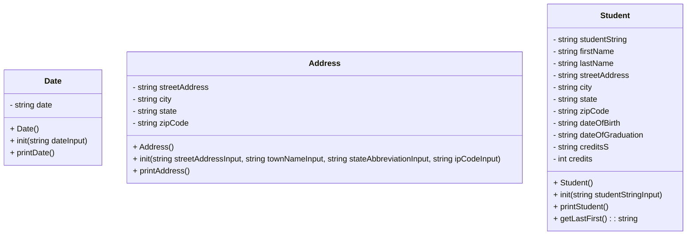

# CS121-Project-7-Heap-Of-Students-Part-2
### This is part 2 of the first heap of students project



## Student::init(std::string studentStringInput)
```
put studentStringInput into studentString
clear ss and converter to make sure they are empty
put studentString into ss
use getline() with a comma delininator to give all the variables their values from the string
when we get to the credits part, instead of putting it directly into the credits variable, put it into creditsS. then put creditsS into converter, and then converter into credits. that makes it into an int
```

## main()
```
include iostream, fstream, sstream, vector, algorithm, Address.h, Date.h, Student.h

void fillVector(reference to vector of students, string fileName)
void printVector(reference to vector of students)
void printStudentNames(reference to vector of students)
bool sortByName(Student a, Student b)

int main() {
    vector of students


}

void fillVector(vector<Student>& v, string fileName) {
    string currentLine
    ifstream inFile

    open fileName in inFile
    while getline(inFile, currentLine)
        add a Student to v with currentLine as it's paramter
        initialize that student
        clear currentLine
}

void printVector(vector<Student>& v) {
    for each item in v
        print attributes of item
}

void printStudentNames(vector<Student>& v) {
    sort v using sortByName
    call printVector
}

bool sortByName(Student a, Student b) {
    return true if Student a's name is less than Student b's name
}
```
